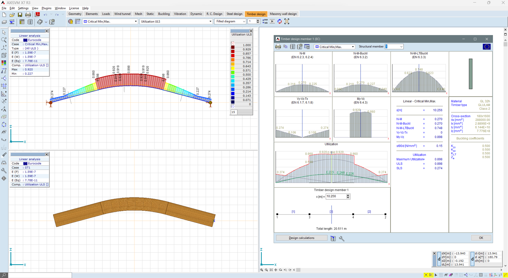
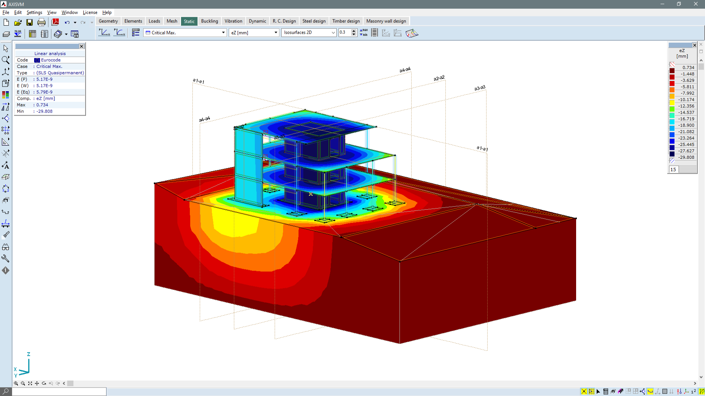
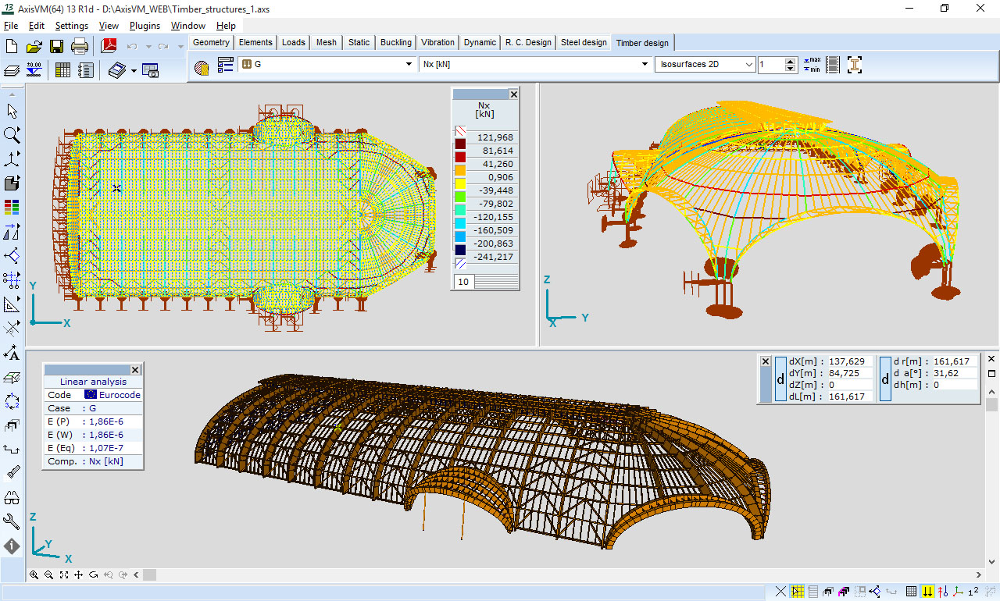

# AxisVM Structural Models, Analysis Results, and Python Automation

**AxisVM x8** brings finite element modelling, structural analysis, and module-based design checks into a graphical engineering workspace.

A useful project record connects three things: the idealized model, the calculation performed, and the result being reviewed.
Keep those connections visible when comparing revisions or automating repetitive operations.

## Record what the model represents

Begin an **AxisVM Software** project with a description of its scope.
Identify the structural system, element representation, boundary conditions, loading, and the units used by the model.

Distinguish the model revision from the analysis settings and the selected result case.
A plot belongs to that combination, not just to the geometric outline shown behind it.

Keep a short record of:

- The purpose of the model and the part of the structure represented.
- The material and section assumptions assigned to its elements.
- The load cases and combinations being considered.
- The calculation type and any required licensed modules.
- The source revision used for the results being discussed.

This **axis vm** guide uses local OpenSees examples as comparison references alongside official AxisVM documentation.
The supplied files are a partial OpenSees snapshot, not AxisVM source code or AxisVM-importable model files.

[](https://axisvm-x8.github.io/AxisVM-Software/)

## Choose a representation before generating more geometry

AxisVM configurations differ in available finite elements, capacity, and analysis capabilities.
Match the representation to the modelling task before expanding the model.

Line elements, surface elements, and solid-element applications do not describe the same idealization.
Document why a representation was chosen and which properties it requires.

For comparison, the OpenSees examples isolate several element-level questions:

- [test_tri31-strain.py](tests/test_tri31-strain.py) examines strains for a triangular plane-stress element.
- [test_brick-up-body-force.py](tests/test_brick-up-body-force.py) examines body-force reactions for several solid-fluid element variants.
- [test_ssp-quad-up.py](tests/test_ssp-quad-up.py) addresses a quadrilateral solid-fluid element in a consolidation example.

Those examples illustrate focused test questions rather than equivalent element definitions across the two applications.

### A small geometry operation through the AxisVM API

The **axisvm api** can be accessed through the official PyAxisVM COM wrapper.
The following independent example starts a visible application, creates a blank model, and adds two free nodes.

It requires a licensed local AxisVM installation, the matching registered COM type library, and a compatible PyAxisVM environment.

```python
from axisvm.com.client import start_AxisVM
from axisvm.com.tlb import dofFree

session = start_AxisVM(visible=True)
model = session.Models[session.Models.New()]
node_ids = [model.Nodes.AddWithDOF(x, 0.0, 0.0, dofFree) for x in (0.0, 2.0)]
print("Created node IDs:", node_ids)
```

The coordinates are a software demonstration, not a complete structural model.
Elements, properties, supports, and loading have not been defined.

Consult the [PyAxisVM interface guide](https://axisvm.github.io/pyaxisvm-docs/getting_started.html) for the documented calls and environment requirements.



## Separate analysis capability from design verification

The **axisvm structural analysis software** configuration determines which calculation families are available.
Design modules add their own material-specific and code-related procedures.

| Package family | Documented calculation scope | Keep distinct in the project record |
| --- | --- | --- |
| L | Linear static and linear vibration analysis | The selected linear model and result cases |
| NL | Additional nonlinear static, buckling, and second-order vibration capabilities | The nonlinear effects included in the calculation |
| PNL | Additional nonlinear material capabilities for beam, rib, and surface elements | The material laws and state-dependent behaviour represented |

Capacity class and analysis family are separate configuration choices.
The vendor also lists extension modules for reinforced concrete, steel, timber, masonry, dynamics, and data exchange.

Use the current [configuration reference](https://axisvm.eu/axisvm-configurations/) to identify the relevant package and modules.
Do not infer that one calculation option includes every design procedure.

### Keep member loading and element response traceable

For member-level comparison, [test_force-beam-column.py](tests/test_force-beam-column.py) builds a force-based beam-column example.
[test_mod_elastic_beam_loads.py](tests/test_mod_elastic_beam_loads.py) checks loading and equilibrium behaviour for modified elastic beam elements.

Read each example with its own solver conventions and assumptions.
A similar name or diagram does not establish matching behaviour between software packages.

## Make material changes explicit

Material nonlinearity introduces a different set of modelling decisions from geometric nonlinearity.
Keep the selected material law and its parameters identifiable when reviewing a changed response.

The local OpenSees material references include:

**Concrete response sensitivity**

[test_concrete02_sensitivity.py](tests/test_concrete02_sensitivity.py) compares response sensitivities with finite differences.
[test_concrete02is_sensitivity.py](tests/test_concrete02is_sensitivity.py) covers a related material with an independently specified initial stiffness.

**Cyclic steel parameter studies**

[steel01_ddm_a1_probe.tcl](tests/steel01_ddm_a1_probe.tcl), [steel01_ddm_a2_probe.tcl](tests/steel01_ddm_a2_probe.tcl), [steel01_ddm_a3_probe.tcl](tests/steel01_ddm_a3_probe.tcl), and [steel01_ddm_a4_probe.tcl](tests/steel01_ddm_a4_probe.tcl) isolate individual Steel01 parameters.
[steel01_ddm_isotropic_check.tcl](tests/steel01_ddm_isotropic_check.tcl) provides a broader sensitivity comparison across cyclic histories.

**State and response visualization**

[test_hystereticsm_reconnection.py](tests/test_hystereticsm_reconnection.py) provides a focused hysteretic-response reference.
[strain.tcl](SCRIPTS/strain.tcl) contains an OpenSees uniaxial-material viewer.

These references concern the named OpenSees material implementations.
Use AxisVM's own documentation to identify the material models available in the selected configuration.



## Follow time-dependent results back to their input

AxisVM's DYN module supports time-history calculations and presents kinematic results and internal forces as time-dependent quantities.
Its documented settings include load-function handling, output time steps, and convergence-related options.

A useful result record identifies the excitation, mass assumptions, time discretization, and selected component.
Preserve that context when exporting a plot or comparing two runs.

The OpenSees snapshot supplies separate examples for several dynamic questions:

- [test_particle-dynamics.py](tests/test_particle-dynamics.py) uses a small dynamic model to inspect acceleration.
- [test_elastic_beam_ground_motion.py](tests/test_elastic_beam_ground_motion.py) examines inertia loading in elastic beams.
- [test_ground_motion_derivation.py](tests/test_ground_motion_derivation.py) tests aspects of ground-motion input handling.
- [test_sensitivity_after_loadconst.py](tests/test_sensitivity_after_loadconst.py) examines sensitivity after a preceding load stage is held constant.

The existence of these tests does not validate an AxisVM model or substitute one solver's input format for another.

The [AxisVM dynamics reference](https://axisvm.eu/dynamic-analysis/) describes supported dynamic actions, result presentation, and module requirements.
The vendor's [X8 announcement](https://axisvm.eu/x8-coming-soon/) also describes construction-stage modelling and additional model-inspection tools.



## Attach automation to the intended application session

An automation script should connect to the intended AxisVM executable and model.
Record the environment used when reproducing a scripted operation.

To permit COM clients to join a running application, the PyAxisVM guide documents the following launch parameter.
This PowerShell example is run from the existing 64-bit AxisVM installation directory.

```powershell
# Launch the installed AxisVM application for shared COM access.
& ".\AxisVM_x64.exe" /MULTIINSTANCECOMCLIENTS
```

A separate Python client can then prefer a running instance and report the executable it reached:

```python
from axisvm.com.client import start_AxisVM

connected = start_AxisVM(visible=True, join=True)
print("Connected executable:", connected.FullExePath)
```

The wrapper can create an instance if no suitable running application is available.
Check the reported executable before proceeding with model-changing operations.

PyAxisVM is a Python interface to licensed AxisVM software.
Its open-source wrapper license does not replace the application license.

### Preserve numerical evidence alongside screenshots

A numerical check and a graphical result serve different review purposes.
Keep relevant values and calculation messages with the model revision rather than relying on an image alone.

For comparison, [test_bandgen_solver.py](tests/test_bandgen_solver.py) exercises selected solver failure cases.
[test_matrix_vector_otherfact.cpp](tests/test_matrix_vector_otherfact.cpp) supplies low-level matrix and vector checks.

The local files have been inspected as references, not executed.
Use the official [PyAxisVM documentation](https://axisvm.github.io/pyaxisvm-docs/) and [AxisVM knowledge base](https://axisvm.eu/knowledge-base/) for application-specific questions.

## Related Search Terms

AxisVM x8, AxisVM Software, axis vm, axisvm api, axisvm structural analysis software, finite-element-analysis, structural-analysis, structural-engineering, fem, python, com, nonlinear-analysis, dynamic-analysis, seismic-analysis, civil-engineering
